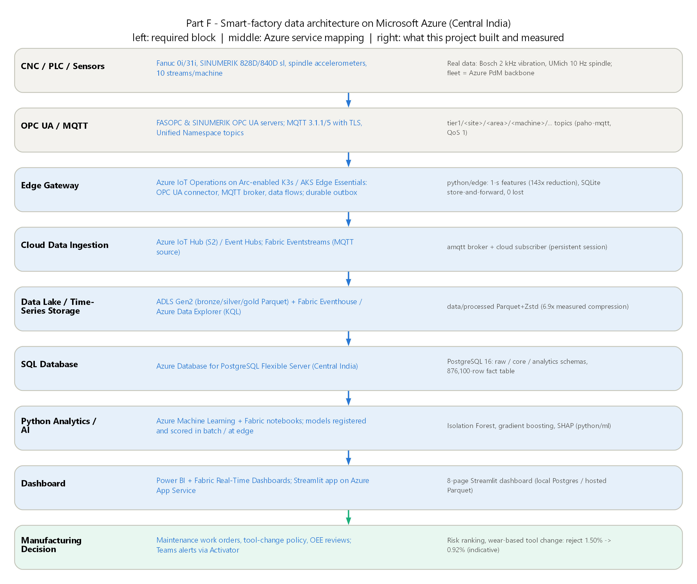
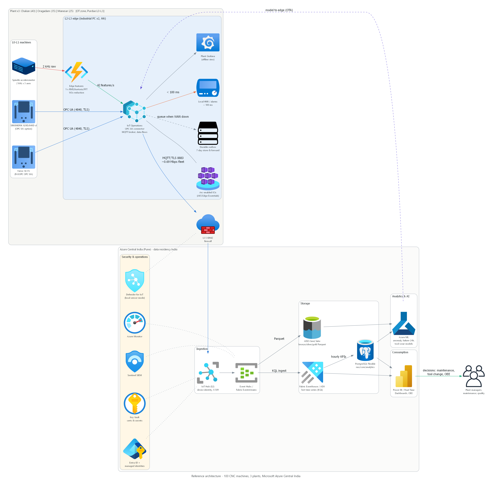

# Industrial Data Platform: Cloud and Data Infrastructure for a 100-Machine Smart Factory

   -1baf7a)  

**Author:** Tirthanker Singh ([@TirthankerSingh](https://github.com/TirthankerSingh)) · **Live dashboard:** [industrial-data-platform.streamlit.app](https://industrial-data-platform.streamlit.app) · **Report:** [`report.pdf`](report.pdf)

Design and justification of a practical cloud-data architecture for a manufacturer running 100 CNC machines in three plants. The analysis is built on **four public datasets** (two of them real factory data), a working PostgreSQL database, an edge-gateway MQTT demo, machine-learning models and an 8-page dashboard.

---

## 1. Problem statement

A manufacturer runs 100 CNC machines across three factories. Every machine produces sensor, production and machine-control data. The company needs scalable infrastructure for monitoring, analytics, storage, dashboards, AI/ML and remote access.

This project answers four questions:
1. How much data the fleet produces.
2. What should be processed at the edge and what in the cloud.
3. Which cloud (AWS, Azure or GCP) fits best, and why.
4. What the end-to-end architecture, database and analytics look like in practice.

## 2. Industrial scenario

An illustrative **automotive Tier-1 supplier in India** (scenario assumptions, `data/reference/`):

| Plant | Shop floor | Machines | Machine types | Parts (cycle time) | Anchoring real data |
|---|---|---|---|---|---|
| **P1 Chakan, Pune** | Powertrain machining | 40 (IDs 1–40) | 24 HMC, 16 VMC | Engine block (14 min), cylinder head (7.5 min), crankcase (11 min) | Bosch vibration |
| **P2 Oragadam, Chennai** | Transmission & driveline | 35 (IDs 41–75) | 15 turning, 10 gear hobbing, 10 grinding | Gear shaft (3.5 min), helical gear (4.5 min), differential housing (6 min) | AI4I temperature / torque / wear |
| **P3 Manesar, Gurugram** | Chassis & brakes | 25 (IDs 76–100) | 17 turning, 8 VMC | Brake disc (2 min), steering knuckle (5 min), wheel hub (3 min) | UMich spindle current, inspection |

- **Machine data:** each machine has 10 sensor streams at 1 Hz plus one spindle accelerometer.
  - The 10 streams: spindle temperature, coolant temperature, spindle vibration, RPM, spindle current, feed-axis load, hydraulic pressure, coolant flow, power and door/cycle status.
  - The accelerometer runs at 2 kHz on 3 axes in reality, and at 100 Hz for the assignment calculation.
- **Controllers:** Fanuc 0i / 31i and Siemens SINUMERIK 828D / 840D sl.
- **Operation:** 24×7, three shifts.

## 3. Dataset description

| # | Dataset | Nature | Source and licence | How it is used |
|---|---|---|---|---|
| 1 | **Bosch CNC Machining**: 1,702 operations, 3 machines, 2 kHz tri-axial vibration, 70 labelled bad | **REAL** (production plant) | Tnani, Feil, Diepold, *Procedia CIRP* 107 (2022); [github.com/boschresearch/CNC_Machining](https://github.com/boschresearch/CNC_Machining); CC-BY-4.0 | Edge feature extraction, measured compression, anomaly detection, vibration scale |
| 2 | **UMich SMART CNC Mill Tool Wear**: 18 experiments, 48 signals at 100 ms, tool condition and inspection labels | **REAL** (CNC machine) | Univ. of Michigan SMART lab, Kaggle `shasun/tool-wear-detection-in-cnc-mill`; mirror [flyinginte/toolwear_cncmilling](https://github.com/flyinginte/toolwear_cncmilling) | Spindle-current calibration, reject model, tool-wear models, MQTT replay |
| 3 | **Microsoft Azure Predictive Maintenance**: 100 machines, hourly telemetry for 2015 (876,100 rows), errors, maintenance, failures | **BENCHMARK** (simulated by Microsoft) | Kaggle `arnabbiswas1/microsoft-azure-predictive-maintenance`; mirror [avidunixuser/telemetry](https://github.com/avidunixuser/telemetry) | Backbone of the 100-machine fleet table; 24-h failure prediction |
| 4 | **AI4I 2020 Predictive Maintenance**: 10,000 rows | **BENCHMARK** (synthetic, reflects real patterns) | Matzka (2020), UCI ML Repository id 601, DOI 10.24432/C5HS5C; CC-BY-4.0 | Temperature model, failure-mode classification |

**Derived data.** The PostgreSQL fleet table `core.machine_data` has 876,100 machine-hours. Its timestamps, RPM, current, vibration (mm/s), temperature, status, production, rejects and alarms are **DERIVED** from the Azure backbone, using models calibrated on the real and benchmark datasets. Every rule is documented in [`data/DATA_PROVENANCE.md`](data/DATA_PROVENANCE.md), and the raw tables are kept in the `raw` schema for traceability. Derived values are never presented as raw sensor readings.

## 4. Software and libraries used

| Area | Software (tested version) |
|---|---|
| Language / runtime | Python 3.13.7, Windows 11, PowerShell |
| Data | numpy 2.5.4, pandas 3.0.6, pyarrow 26.0.0, scipy 1.18.1, h5py 3.16.0 |
| Database | PostgreSQL 16.15 (Docker image `pgvector/pgvector:pg16`; any PostgreSQL 16/17 works), psycopg 3.3.6 |
| ML | scikit-learn 1.9.1, shap 0.54.1 |
| Visualisation | matplotlib 3.11.2, seaborn 0.13.2, plotly 7.1.0 |
| Dashboard | Streamlit 1.66.0 |
| Edge / IoT demo | paho-mqtt 2.1.0, amqtt 0.12.1 (pure-Python MQTT broker) |
| Diagrams / documents | Graphviz 16.1.0, diagrams 0.25.1, graphviz 0.20.3, openpyxl 3.1.5, python-pptx 1.0.2 |

Pinned versions: [`python/requirements.txt`](python/requirements.txt) (full) and [`dashboard/requirements.txt`](dashboard/requirements.txt) (hosted app).

## 5. Instructions for running the code (Windows PowerShell)

```powershell
# 1. Clone and enter the repository
git clone https://github.com/TirthankerSingh/industrial-data-platform.git
cd industrial-data-platform

# 2. Prerequisites: Python 3.11+, Git, Graphviz, PostgreSQL 16/17
winget install Graphviz.Graphviz

# 3. Database connection (see section 6), then copy the example config and edit the password
Copy-Item .env.example .env
Copy-Item dashboard\.streamlit\secrets.toml.example dashboard\.streamlit\secrets.toml

# 4. Run everything: downloads ~1 GB of datasets into ..\raw_datasets, builds tables, loads
#    PostgreSQL, runs queries, trains models, regenerates every figure and diagram
powershell -ExecutionPolicy Bypass -File .\run_all.ps1            # add -WithMqtt for the MQTT demo, -SkipDb without PostgreSQL

# 5. Dashboard
cd dashboard
..\.venv\Scripts\streamlit.exe run app.py                       # http://localhost:8501
```

Individual steps are numbered and rerunnable. For example:

```powershell
.\.venv\Scripts\python.exe python\05_build_fleet_table.py
```

**MQTT demo with three terminals:** run `python\edge\mqtt_broker.py`, then `python\edge\cloud_subscriber.py`, then `python\edge\edge_gateway.py --speed 5`. Stop and restart the broker to watch the gateway buffer and then flush.

## 6. SQL database instructions

1. Create a PostgreSQL 16/17 database and user, with either a native install or Docker:
   ```powershell
   docker run -d --name idp-postgres -e POSTGRES_PASSWORD=postgres -p 5432:5432 postgres:17
   docker exec -it idp-postgres psql -U postgres -c "CREATE ROLE idp_user LOGIN PASSWORD 'change-me';" -c "CREATE DATABASE industrial OWNER idp_user;"
   ```
2. Put the connection in `.env` (copied from `.env.example`).
3. Create the schema and bulk-load with `python python\06_load_postgres.py`. This runs [`sql/01_schema.sql`](sql/01_schema.sql), then uses COPY to load reference tables, 876,100 fact rows and 921k raw source rows in about 30 s.
4. Run the queries with `python python\07_run_sql.py`. It runs [`sql/03_required_queries.sql`](sql/03_required_queries.sql) (the 8 required questions) and [`sql/04_advanced_queries.sql`](sql/04_advanced_queries.sql) (OEE, MTBF/MTTR, shifts, alarm Pareto, trends, anomalies, views). Each result is saved to `sql/results/<query>.csv`. The queries can also be pasted into psql or pgAdmin.

**Schema** (ER diagram: `diagrams/04_er_diagram.png`):
- `raw.*`: the source datasets as published.
- `core.plant`, `shop_floor`, `machine_type`, `part_family`, `machine`, `alarm_master`, `event`.
- `core.machine_data`: one row per machine-hour, with primary key `(machine_id, ts)`, foreign keys, CHECK constraints, a status ENUM, and indexes on `ts` and `(plant_id, ts)`.
- `analytics.v_machine_data_required` exposes the exact assignment column names (`Machine_ID`, `Timestamp`, `Temperature`, `Vibration`, `RPM`, `Current`, `Production_Count`, `Machine_Status`, `Alarm`).
- A TimescaleDB production path (hypertable, continuous aggregates, compression) is included, commented, in the schema file.

## 7. Key findings

| Topic | Finding |
|---|---|
| **Data volume (A)** | 1,000 values/s, 3.6 M/h, 86.4 M/day, 2.592 B/month, **31.536 B/year** for the 1 Hz fleet. One 100 Hz sensor: 3.15 B/year. One 100 Hz sensor on every machine: 315 B/year, ten times the 1 Hz fleet. Raw 2 kHz tri-axial on 100 machines: 96 Mbps and 378 TB/year. |
| **Measured compression (A)** | Parquet+Zstd: **6.9×** on real UMich CNC signals, but only **5.0×** on real Bosch vibration, because noise does not compress. |
| **Edge features (A, G)** | 42 features/s per machine instead of 6,000 samples: **143× smaller** (120× measured over 24.8 h of real data). Fleet uplink 19.2 → 0.13 Mbps; 75.7 → 0.53 TB/year. Good and bad operations stay separable (ROC-AUC 0.98). |
| **Cloud comparison (B)** | Verified on 2026-10-21: GCP IoT Core retired 2023; Azure Time Series Insights retired 2024; AWS IoT Analytics and IoT Events end of support 2025/2026; Azure IoT Central retirement announced for 2029. |
| **Decision (C)** | Weighted scores: **Azure 4.22**, AWS 3.92, GCP 3.57 (10 criteria). Azure wins every ±5-point weight shift and 88.7% of 10,000 Monte-Carlo runs; AWS wins only if cost is weighted ≥ 35%. |
| **Cost (C)** | Edge-batched design: ₹33k–80k/month. One MQTT message per reading would cost ₹14–30 lakh/month, so edge batching is the largest cost lever. Raw 2 kHz to the cloud costs ₹1.2–3.9 lakh/month more. |
| **SQL (D)** | Most parts: P3-TURN-05 (brake discs, 199,677). Highest rejection rate: P2-GRIND-06, 1.97%. Longest continuous run: P1-HMC-18, 209 h. Fleet OEE ≈ 75%. MTBF 373–480+ h; MTTR ≈ 8 h. |
| **MQTT edge demo (F, G)** | Real data replayed through gateway → broker → PostgreSQL across a subscriber outage and a WAN outage: **482 produced, 482 stored, 0 lost, 0 duplicates**. |
| **ML** | Bosch anomaly ROC-AUC 0.98 (trained on good only), 0.98 on a 2019 → 2021 hold-out. UMich worn-tool detection **does not generalise** across experiments (0.37 vs 0.72 with a leaky split), reported honestly. Azure 24-h failure prediction is near-perfect on the *simulated* benchmark. AI4I physics features raise PR-AUC to 0.99. |
| **Business impact** | About **₹5.8 crore/year** (indicative, stated assumptions): predictive maintenance ₹2.1 crore; wear-based tool change ₹3.8 crore (reject rate 1.50% → 0.92%). |
| **Recommendation** | **Microsoft Azure (Central India)** with an edge-first design: IoT Operations OPC UA at each plant, a durable 7-day outbox, IoT Hub / Event Hubs → Eventhouse + ADLS → PostgreSQL Flexible → Azure ML → Power BI. The full argument is in [`docs/part_c_decision.md`](docs/part_c_decision.md). |

## 8. Architecture overview





**More diagrams:**
- [Security zones (Purdue / IEC 62443)](diagrams/03_security_zones.png)
- [ER diagram](diagrams/04_er_diagram.png)
- [Data pipeline](diagrams/05_data_pipeline.png)
- [Edge vs cloud](diagrams/06_edge_vs_cloud.png)

**Part write-ups:**
- [A: Data volume](docs/part_a_data_volume.md)
- [B: Cloud comparison](docs/part_b_cloud_comparison.md)
- [C: Decision matrix](docs/part_c_decision.md)
- [Cost model](docs/cost_model.md)
- [F: Architecture](docs/part_f_architecture.md)
- [G: Edge vs cloud](docs/part_g_edge_vs_cloud.md)
- [Sources (81 official references)](docs/sources.md)

---

### Screenshot gallery

| | |
|---|---|
| `[SCREENSHOT: dashboard - fleet overview]` | `[SCREENSHOT: dashboard - machine health]` |
| `[SCREENSHOT: dashboard - edge demo]` | `[SCREENSHOT: pgAdmin - required query results]` |
| `[SCREENSHOT: MQTT publisher / subscriber terminals]` | `[SCREENSHOT: GitHub commit history]` |

### Repository map

```
industrial-data-platform/
├── data/
│   ├── reference/        plant, shop_floor, machine_type, part_master, machine_master, alarm_master, calibration.json, cloud_prices.json
│   ├── processed/        machine_data.parquet (876,100 rows), events, Bosch features, PdM risk scores  (hosted-dashboard snapshot)
│   ├── samples/          small REAL samples: Bosch raw 2 kHz (10 s good + bad), UMich experiment
│   └── DATA_PROVENANCE.md
├── python/
│   ├── 00_download ... 07_run_sql.py   numbered, rerunnable pipeline
│   ├── part_a_data_volume.py, part_c_decision_matrix.py, make_diagrams.py
│   ├── edge/             Bosch feature extraction, MQTT broker, gateway, subscriber, automated demo
│   ├── ml/               anomaly detection, tool wear, failure prediction, failure modes, INR impact
│   └── utils/            paths, style, database helper
├── sql/                  01_schema, 03_required_queries, 04_advanced_queries, results/
├── dashboard/            Streamlit app.py + 8 pages, lib/, .streamlit/config.toml
├── diagrams/             architecture, security zones, ER, pipeline, edge-vs-cloud (PNG + SVG + .dot)
├── docs/                 part write-ups, cost model, sources, decision_matrix.xlsx, figures/, results/, screenshots/
├── run_all.ps1           one-command rebuild
├── README.md
└── report.pdf
```

**Licence:** code under the MIT licence ([LICENSE](LICENSE)). Datasets remain under their original licences (CC-BY-4.0 for Bosch and AI4I; see the sources for UMich and Azure PdM). Raw datasets are not stored in this repository.
